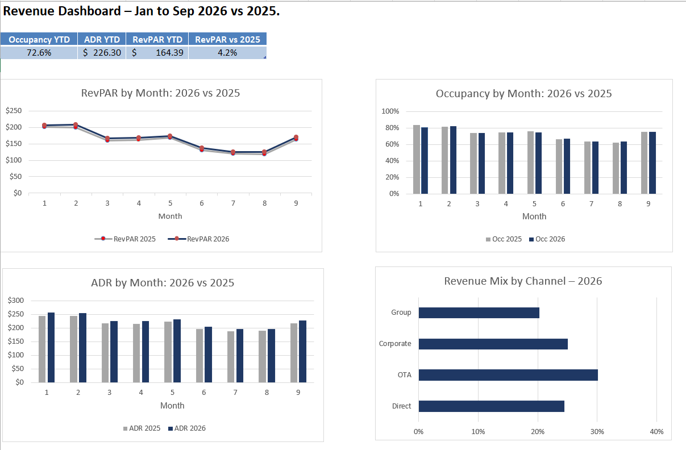
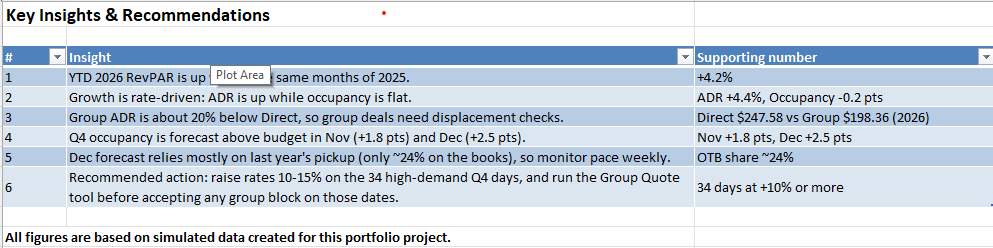
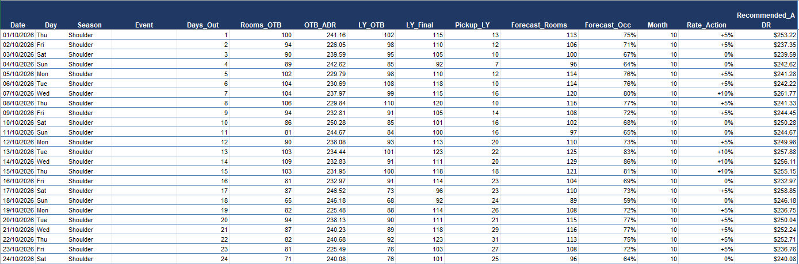
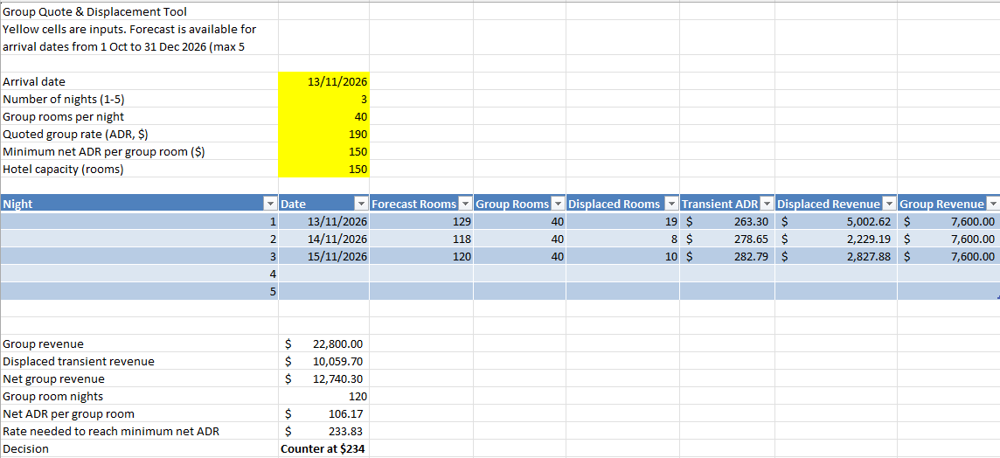
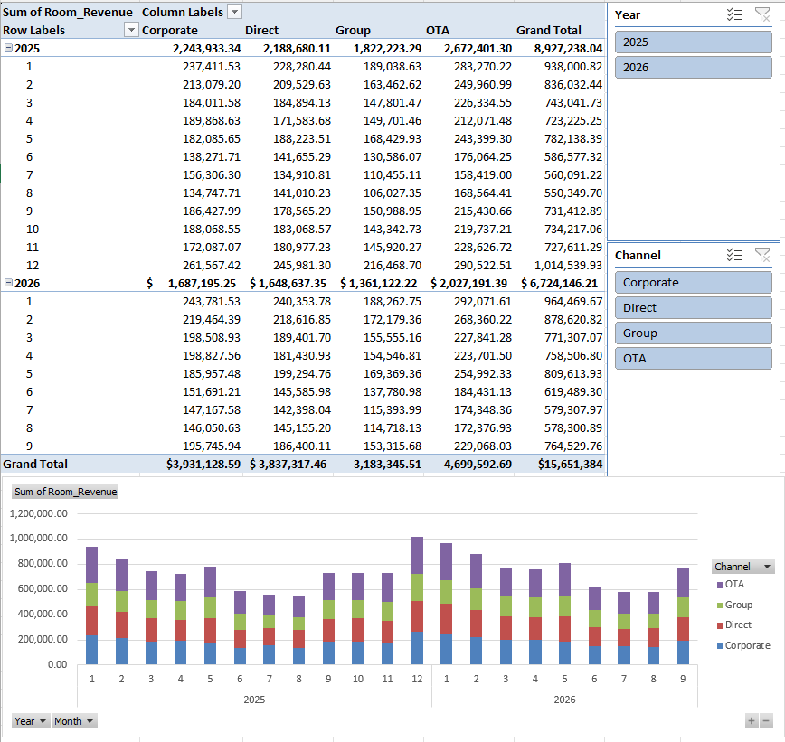

# Hotel Revenue Management Workbook (Excel)

A revenue management model for a simulated 150-room Sydney hotel. All data is simulated for portfolio purposes.

## What it does
- **KPIs:** monthly Occupancy, ADR and RevPAR with year-on-year comparison
- **Forecast:** 90-day pickup forecast (rooms on the books + last year's pickup) vs budget
- **Pricing:** rule-based rate recommendations by forecast occupancy
- **Group Quote:** displacement analysis, net ADR and counter-offer rate for group requests
- **Channel Pivot:** PivotTable with slicers for revenue by channel
- **Insights:** written findings and recommended actions

## Key findings
- YTD 2026 RevPAR is up 4.2% vs 2025, driven by ADR (+4.4%) while occupancy is flat.
- Q4 occupancy is forecast above budget in Nov (+1.8 pts) and Dec (+2.5 pts).
- 34 high-demand Q4 days are flagged for rate increases of 10-15%.

## Screenshots

### Dashboard

### Insights

### Forecast and pricing

### Group quote tool

### Channel PivotTable

## Skills demonstrated
SUMIFS, XLOOKUP, structured tables, PivotTables and slicers, charts, data validation, forecasting and scenario inputs.

## Files
- `Hotel_Revenue_Management_Workbook.xlsx` - the workbook
- `Dashboard.pdf` - dashboard export
